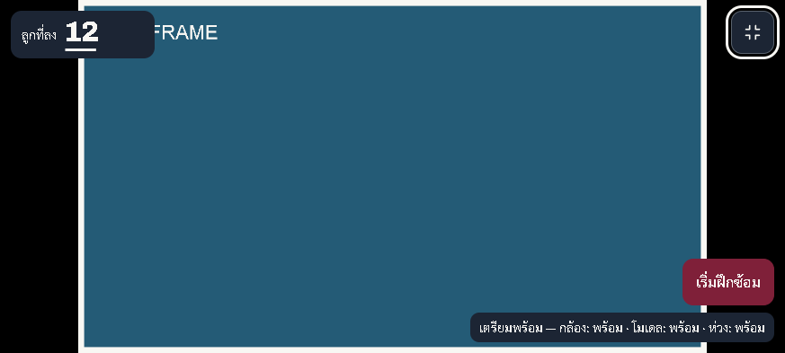
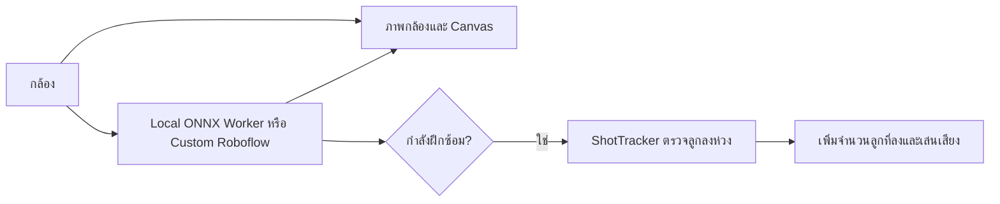

<div align="center">

# Hoop Shot Counter

**เว็บนับลูกบาสลงห่วงจากกล้อง สำหรับซ้อมคนเดียว**

[](https://hoop-three.vercel.app/)
[](src/main.js)
[](package.json)
[](#settings)
[](#settings)
[](src/sound-manager.js)
[](#quick-start)
[](LICENSE)

เปิดกล้อง เตรียมห่วง แล้วเริ่มซ้อม พร้อมคะแนนและเสียงเมื่อตรวจพบลูกลงห่วง

🏀 **ใช้งานออนไลน์ได้ทันที (HTTPS พร้อมเปิดกล้อง):** [https://hoop-three.vercel.app/](https://hoop-three.vercel.app/)

[เริ่มรัน](#quick-start) · [ฟีเจอร์](#features) · [ภาพตัวอย่าง](#preview) ·
[วิธีซ้อม](#practice) · [เปิดบนมือถือ](#mobile) · [โมเดลและการตั้งค่า](#settings)

[การทำงาน](#how-it-works) · [ทดสอบ](#tests) · [คำถามที่พบบ่อย](#faq) ·
[แก้ปัญหา](#troubleshooting) · [โครงสร้าง](#structure) · [ร่วมพัฒนา](#contributing)

</div>

<a id="features"></a>

## ฟีเจอร์เด่น

- **กล้องเป็นหลัก** — ภาพครบเฟรมทั้งแนวตั้งและแนวนอน กดขยายเต็มพื้นที่จอพร้อม UI ลอย
- **เริ่มนับเมื่อพร้อม** — ตรวจสถานะกล้อง โมเดล และห่วงก่อนเปิดปุ่มเริ่มซ้อม
- **พักและซ้อมต่อ** — คะแนนและภาพกล้องยังอยู่ เปลี่ยนกล้องหรือกรอบห่วงแล้วพักการนับอัตโนมัติ
- **ล็อกห่วงเองได้** — ลากหรือแตะสองมุม ตรวจกรอบร่าง แล้วค่อยยืนยันหรือยกเลิก
- **ใช้โมเดล local เป็นหลัก** — Local Swish / Swish INT8 ผ่าน Web Worker พร้อม WebGPU/WASM fallback และช่อง Custom API สำหรับโมเดลของคุณเอง
- **เสียงและสองภาษา** — เลือกเสียงสำเร็จรูป สุ่มเสียง หรือใช้ไฟล์ตัวเอง พร้อม UI ไทย/อังกฤษ

<a id="preview"></a>

## ภาพตัวอย่าง



ภาพจากแอปจริงใน desktop browser โดยใช้ **TEST FRAME จำลอง** เพื่อแสดงตำแหน่ง UI
ภาพนี้ไม่ใช่หลักฐานการตรวจลูกบาสหรือผลทดสอบกล้องบนมือถือจริง

> หนึ่งครั้งที่ตรวจพบว่าลงห่วง จะเพิ่มจำนวนลูกที่ลง 1 ครั้ง
> ความแม่นยำและความเร็วขึ้นกับโมเดล มุมกล้อง แสง และอุปกรณ์

<a id="quick-start"></a>

## เริ่มรัน

ต้องมี Node.js `^20.19.0 || >=22.12.0`, npm และกล้องที่เบราว์เซอร์เข้าถึงได้

```sh
git clone https://github.com/dechatorn-L/Hoop.git
cd Hoop
npm ci
npm run dev
```

เปิด [https://localhost:5173](https://localhost:5173) และตรวจ URL ที่ Vite แสดงใน terminal
เซิร์ฟเวอร์พัฒนาใช้ใบรับรอง HTTPS แบบ self-signed จึงอาจมีข้อความเตือนจากเบราว์เซอร์
กด `Ctrl+C` ใน terminal เพื่อหยุดเซิร์ฟเวอร์

**ไม่ต้องสร้าง `.env` เพื่อใช้ Local ONNX** แอปใช้ Local Swish เป็นค่าเริ่มต้น แม้มี Roboflow key อยู่แล้ว
ไฟล์โมเดล Swish และ Swish INT8 อยู่ใน `public/models/`

<a id="practice"></a>

## วิธีซ้อม

1. วางอุปกรณ์ให้มั่นคง ให้เห็นห่วงและทางผ่านของลูกบาส
2. กด **เปิดกล้อง** แล้วอนุญาตสิทธิ์กล้อง เลือกกล้องที่ต้องการใน **การควบคุม**
3. รอให้กล้อง โมเดล และกรอบห่วงพร้อม หากตรวจห่วงไม่พบ ให้กด **ล็อกห่วง**
4. กำหนดกรอบด้วยการลากหรือแตะสองมุม แล้วกด **ยืนยันกรอบห่วง**
5. กด **เริ่มฝึกซ้อม** จึงเริ่มนับลูกที่ลง การเตรียมกล้องอย่างเดียวจะยังไม่นับ
6. กด **พักการฝึกซ้อม** เพื่อพัก คะแนนและภาพกล้องยังอยู่ กด **ฝึกซ้อมต่อ** เพื่อซ้อมต่อ

| การทำงาน | สิ่งที่เกิดขึ้น |
| --- | --- |
| ขยายกล้อง | กล้องใช้เต็มพื้นที่จอ คะแนนและปุ่มควบคุมลอยบนภาพ |
| กดไอคอนย่อมุมขวาบน | กลับหน้าปกติ โดยคงคะแนนและสถานะการซ้อม |
| เปลี่ยนกล้องหรือแก้กรอบห่วง | พักการนับ ต้องตรวจความพร้อมและกดซ้อมต่อเอง |
| ยกเลิกกรอบห่วง | เก็บกรอบเดิมและคะแนน ไม่บันทึกกรอบร่าง |
| รีเซ็ต | ขอการยืนยันก่อนล้างคะแนน โดยเก็บการตั้งค่ากล้อง ห่วง โมเดล และเสียง |
| ยกเลิกลูกล่าสุด | ถอนคะแนนล่าสุดได้หนึ่งครั้งต่อการนับใหม่ โดยคงสถานะซ้อมและช่วงกันนับซ้ำ ในจอขยายหรือจอแคบใช้ปุ่มไอคอนข้างคะแนน |

เปิด **การควบคุม → วิธีจัดวางกล้อง** เพื่อดูภาพฐานรอง/ขาตั้งและกรอบภาพที่เห็นห่วงกับทางเดินลูก พร้อมรายการตรวจกรอบห่วง ภาพเป็นแนวทางให้ปรับจากภาพกล้องจริง ไม่ใช่มุมกล้องที่ผ่านการสอบเทียบ

ภาพกล้องแสดงครบเฟรม ไม่ตัดขอบ หากสัดส่วนภาพต่างจากจอ อาจมีขอบดำ
กรอบตรวจจับและตำแหน่งห่วงใช้พิกัดภาพเดียวกันทั้งแนวตั้งและแนวนอน
ระหว่างตีกรอบห่วง ปุ่มยืนยัน/ยกเลิกจะอยู่ภายนอกภาพเพื่อไม่บังจุดที่ต้องเลือก

หากเบราว์เซอร์ไม่รองรับหรือปฏิเสธ fullscreen แอปจะขยายภายในหน้าเว็บแทน
คะแนนปัจจุบันไม่ได้เก็บเป็นประวัติข้ามการรีโหลดหน้า

<a id="mobile"></a>

## เปิดบนมือถือ

### ผ่านเว็บโฮสติ้ง (แนะนำ สะดวกที่สุด ไม่ต้องเปิดคอม)

เปิดผ่าน [https://hoop-three.vercel.app/](https://hoop-three.vercel.app/) บนเบราว์เซอร์ของโทรศัพท์ได้โดยตรง มี HTTPS รองรับการอนุญาตเข้าถึงกล้องทันที

### ผ่าน Cloudflare Tunnel (สำหรับการพัฒนาในเครื่อง)

```sh
npm run tunnel:cf
```

สคริปต์จะใช้เซิร์ฟเวอร์ที่พอร์ต `5173` หรือเปิด Vite ให้หากยังไม่มี
เปิดลิงก์ HTTPS ชั่วคราวที่ terminal แสดงบนมือถือ ไม่จำเป็นต้องใช้ Wi-Fi เดียวกัน
URL นี้เข้าถึงได้จากภายนอกเครื่อง จึงควรแชร์เฉพาะผู้ที่ต้องการให้ทดสอบ

กด `Ctrl+C` เพื่อปิด tunnel สคริปต์จะสั่งหยุด Vite ที่มันเปิดให้ด้วย
หากเปิด Vite เองอยู่ก่อน ให้หยุดจาก terminal ของ Vite แยกต่างหาก

### ผ่านเครือข่ายเดียวกัน

เปิด Vite ด้วย `npm run dev` แล้วเปิด terminal อีกหน้าหนึ่ง:

```sh
npm run ip
```

นำ URL รูปแบบ `https://<IP-ของคอม>:5173/` ไปเปิดบนมือถือที่อยู่เครือข่ายเดียวกัน
ตรวจ firewall และใบรับรอง HTTPS หากเข้าไม่ได้

การเข้าถึงกล้องต้องใช้ secure context การเปิดหน้าเว็บได้หรือผ่านคำเตือนใบรับรองได้
ยังไม่รับรองว่าเบราว์เซอร์จะอนุญาตกล้อง หากติดปัญหาใบรับรอง ให้ใช้ tunnel ที่มี HTTPS ใช้งานได้

<a id="settings"></a>

## โมเดลและการตั้งค่า

เปิด **การควบคุม → การตั้งค่า** เพื่อเลือกภาษา โมเดล เสียง ระดับเสียง และความไวตรวจจับ
เปลี่ยนภาษาไทย/อังกฤษได้ทันที โดยไม่เริ่มกล้องใหม่หรือล้างคะแนน

### เลือกโมเดล

| ตัวเลือก | การทำงาน | สิ่งที่ต้องมี |
| --- | --- | --- |
| Local ONNX: Swish-Vision (ค่าเริ่มต้น) | ตรวจจับในเครื่องผ่าน Web Worker | `public/models/basketball_swish_yolov8.onnx` |
| Local ONNX: Swish INT8 | ทางเลือกโมเดลขนาดเล็กกว่า | `public/models/basketball_swish_yolov8_int8.onnx` |
| Roboflow: Custom Model ID | ช่องเชื่อมต่อ API ของผู้ใช้ ไม่มีโมเดลสำเร็จรูป | Model ID รูปแบบ `project/version`, publishable key และอินเทอร์เน็ต |

ถอด API preset เดิม Main / Cricket / Devin Ross ออกแล้ว ค่าที่เคยเลือกไว้จะกลับมาใช้ Local Swish
การเลือก Local Swish INT8 หรือ Custom เดิมยังคงอยู่ รวมถึง Model ID / key ที่ผู้ใช้บันทึกไว้

Local ONNX จะลอง WebGPU ก่อน และใช้ WASM หากเริ่ม WebGPU ไม่ได้
Custom Roboflow โหลดไม่สำเร็จจะลอง Local Swish แทน หากโมเดลสำรองพร้อมใช้งาน

**Local inference ไม่ได้แปลว่าออฟไลน์ทั้งหมด** ตัว worker ยังอ้างอิงไฟล์ runtime จาก CDN
การใช้งานจึงอาจต้องโหลดทรัพยากรผ่านอินเทอร์เน็ต ไม่มีการรับรอง FPS หรือความแม่นยำเท่ากันทุกเครื่อง

`ROI Turbo` จำกัดพื้นที่ตรวจจับรอบห่วงในเส้นทาง Roboflow เมื่อมีกรอบห่วง
ผลด้านความเร็วขึ้นกับโมเดลและอุปกรณ์ ไม่ใช่คำรับรองว่าจะเร็วขึ้นตามอัตราตายตัว

### Roboflow key และ `.env`

หากต้องการใช้ API ให้เลือก **Roboflow: Custom Model ID** แล้วกรอก Model ID และ publishable key ของคุณ
หรือกำหนด `VITE_ROBOFLOW_API_KEY` ใน `.env` แทนการกรอก key ในหน้าเว็บ
หากยังไม่มี `.env` คัดลอกแม่แบบด้วย PowerShell โดยไม่ทับไฟล์เดิม:

```powershell
if (!(Test-Path .env)) { Copy-Item .env.example .env }
```

เปลี่ยนค่า placeholder เป็น publishable key ของคุณ เฉพาะเมื่อจะใช้ Custom API
กรอก Model ID ในแอปโดยตรง ตัวแปร `VITE_ROBOFLOW_MODEL_ID` เดิมไม่ได้ใช้แล้ว
การมี key ใน `.env` ไม่เปลี่ยนค่าเริ่มต้นจาก Local Swish เป็น API
หลังแก้ `.env` ให้เริ่ม Vite ใหม่

- ตัวแปร `VITE_*` อยู่ในโค้ดที่ส่งให้เบราว์เซอร์ ใช้เฉพาะ key ที่เผยแพร่ฝั่ง client ได้
- Custom Roboflow key ที่กรอกในแอปถูกเก็บใน `localStorage` ของเบราว์เซอร์นั้น
- `NOTION_API_KEY` และ `NOTION_API_VERSION` ใช้กับตัวติดตามงานเท่านั้น ไม่จำเป็นต่อการเปิดแอป และห้ามใช้ชื่อขึ้นต้น `VITE_`
- อย่า commit `.env` หรือใส่ private key ใน README

### เสียงและข้อมูลที่จำไว้

เลือกเสียงสำเร็จรูป สุ่มเสียง หรืออัปโหลดไฟล์เสียงของตัวเองได้ ขนาดสูงสุด 10 MiB
กด **ทดสอบเสียง** และปรับระดับเสียงก่อนซ้อม ไฟล์เสียงที่อัปโหลดต้องเลือกใหม่หลังรีโหลดหน้า

แอปจำภาษา โมเดล กรอบห่วง และตัวเลือก ROI ผ่าน `localStorage` เมื่อเบราว์เซอร์อนุญาต
การล้างข้อมูลเว็บไซต์จะล้างค่าที่บันทึกไว้ด้วย

<a id="how-it-works"></a>

## แอปทำงานอย่างไร



การตรวจจับแยกจากการวาดภาพ คะแนนอัปเดตผ่านสถานะฝึกซ้อม
ช่วงเตรียมพร้อมหรือพักยังแสดงภาพได้ แต่ไม่เพิ่มคะแนน
พิกัดห่วงและกล่องตรวจจับอ้างอิงขนาดภาพต้นทาง แม้ขนาดพื้นที่แสดงผลเปลี่ยนไป

<a id="tests"></a>

## คำสั่งพัฒนาและทดสอบ

| คำสั่ง | ใช้ทำอะไร |
| --- | --- |
| `npm ci` | ติดตั้ง dependency ตาม lockfile |
| `npm run dev` | เปิดเซิร์ฟเวอร์พัฒนา HTTPS ที่พอร์ต 5173 |
| `npm run build` | สร้างไฟล์ production ใน `dist/` |
| `npm run preview` | เปิดดู build บนเครื่อง ดู URL จาก terminal |
| `npm run tunnel:cf` | เปิด tunnel และเปิด Vite ให้หากจำเป็น |
| `npm run ip` | แสดง IP และ URL สำหรับเครือข่ายเดียวกัน |
| `node tests/repro-test.mjs` | ตรวจ scoring และ sound-selection logic |

Browser tests ต้องมีแพ็กเกจ `playwright` และ Chromium ที่เรียกใช้งานได้
แพ็กเกจนี้ไม่ได้อยู่ใน dependencies ของแอป จากนั้นเปิด `npm run dev` ค้างไว้และรัน:

```sh
node tests/practice-test.mjs
node tests/camera-view-test.mjs
node tests/detection-test.mjs
```

| ตัวแปรสำหรับ browser tests | ความหมาย |
| --- | --- |
| `HOOP_PLAYWRIGHT_MODULE` | ชื่อหรือ absolute path ของแพ็กเกจ Playwright ที่ติดตั้งไว้ |
| `HOOP_BROWSER_CHANNEL` | เลือก browser channel เช่น `chrome` หรือ `msedge` หากติดตั้งไว้ |
| `HOOP_TEST_URL` | URL เซิร์ฟเวอร์ทดสอบ ค่าเริ่มต้นคือ `https://localhost:5173/` |

ชุดทดสอบครอบคลุมการเริ่ม/พักซ้อม ภาษา การบันทึกค่า กรอบห่วง การหมุนจอ
การขยายกล้อง และการรักษาคะแนน บางกรณีใช้ผลกล้อง/โมเดลจำลองหรือภาพทดสอบที่ระบุชัด
ผลผ่านใน desktop browser ไม่แทนการทดสอบกล้อง เสียง และการสัมผัสบนมือถือจริง

### สถานะการตรวจสอบ

มี automated browser checks และ feedback หน้าจอจาก Xiaomi 13 แล้ว
การยอมรับ UI แยกจากการตรวจซ้อมจริง 10 นาที รวมถึงความแม่นยำ เสียง แสง และการหมุนจอบนอุปกรณ์จริง
ไม่ถือว่า Safari, iPad หรือ Android tablet ผ่านการทดสอบจากผลบน desktop หรือ Xiaomi เพียงเครื่องเดียว
ติดตามงานและหลักฐานล่าสุดใน [Notion: Hoop Shot Counter](https://app.notion.com/p/3f48a6cad3568165aa11d2cebc7d11ad) ซึ่งต้องมีสิทธิ์เข้าถึง

<a id="faq"></a>

## คำถามที่พบบ่อย

<details>
<summary>ต้องมี Roboflow key ก่อนหรือไม่?</summary>

ไม่ต้องมีหากใช้ Local ONNX เมื่อไม่มี key แอปจะเลือก Local Swish แทน
หากต้องการ Roboflow ให้ใช้ publishable key ตามหัวข้อ [โมเดลและการตั้งค่า](#settings)

</details>

<details>
<summary>ใช้โดยไม่ต่ออินเทอร์เน็ตได้ทั้งหมดหรือไม่?</summary>

ยังไม่รับรองการทำงานแบบออฟไลน์ทั้งหมด แม้ Local ONNX จะประมวลผลในเครื่อง
ตัว worker ยังอ้างอิงไฟล์ runtime จาก CDN ส่วน Roboflow ต้องโหลดทรัพยากรจากผู้ให้บริการ

</details>

<details>
<summary>ขยายกล้องแล้วตัดภาพหรือทำให้คะแนนหายหรือไม่?</summary>

แอปคงภาพครบเฟรม จึงอาจเหลือขอบดำหากสัดส่วนกล้องต่างจากจอ
การขยายและย่อคงคะแนน กล้อง และสถานะซ้อมไว้ ต่างจากการรีโหลดหน้าซึ่งเริ่มคะแนนใหม่

</details>

<a id="troubleshooting"></a>

## แก้ปัญหาเบื้องต้น

| อาการ | ตรวจอะไร |
| --- | --- |
| เปิดกล้องไม่ได้ | ตรวจ HTTPS สิทธิ์กล้องของเว็บไซต์ และปิดแอปอื่นที่ใช้กล้องอยู่ |
| ปุ่มเริ่มซ้อมกดไม่ได้ | อ่านสถานะกล้อง โมเดล และห่วง หากไม่มีห่วง ให้กำหนดกรอบเอง |
| โมเดลโหลดไม่สำเร็จ | ตรวจอินเทอร์เน็ต key/Model ID และไฟล์โมเดลใน `public/models/` จากนั้นเลือกโมเดลและกดเปลี่ยนโมเดลใหม่ |
| เสียงไม่ออก | แตะหน้าเว็บหรือกดทดสอบเสียง ตรวจระดับเสียงในแอปและอุปกรณ์ |
| ขยายแล้วยังมีขอบดำ | เป็นพื้นที่ส่วนเกินจากสัดส่วนจอกับกล้อง ภาพยังแสดงครบเฟรม |
| เข้าเว็บผ่านมือถือไม่ได้ | ตรวจ URL จาก terminal, เครือข่าย, firewall และว่าเซิร์ฟเวอร์ยังทำงานอยู่ |
| อ่านค่าที่บันทึกไม่ได้ | เบราว์เซอร์อาจปิด storage ใช้ค่าปัจจุบันต่อได้ แต่บางค่าอาจไม่ถูกจำ |

<a id="structure"></a>

## โครงสร้างโปรเจกต์

| ไฟล์/โฟลเดอร์ | หน้าที่ |
| --- | --- |
| [index.html](index.html) | หน้าซ้อม ปุ่มควบคุม และหน้าตั้งค่า |
| [styles/index.css](styles/index.css) | ธีม Court Journal และ layout ปกติ/เต็มจอ |
| [src/main.js](src/main.js) | ประสานกล้อง โมเดล สถานะซ้อม คะแนน และเสียง |
| [src/camera.js](src/camera.js) | ขอสิทธิ์ เปิด/เปลี่ยนกล้อง และปล่อย stream |
| [src/detector.js](src/detector.js) | เลือก provider จัดการ detection, ROI และ fallback |
| [src/onnx-worker-detector.js](src/onnx-worker-detector.js) | ดูแล ONNX worker และผลตรวจจับ |
| [src/worker/onnx.worker.js](src/worker/onnx.worker.js) | เตรียมภาพและรัน ONNX ผ่าน WebGPU/WASM |
| [src/shot-tracker.js](src/shot-tracker.js) | ติดตามลูกบาส ตรวจลูกลงห่วง และคุม cooldown |
| [src/ui.js](src/ui.js) | กล้องเต็มจอ กรอบห่วง คะแนน และพฤติกรรม UI |
| [src/i18n.js](src/i18n.js) | ข้อความภาษาไทย/อังกฤษ |
| [src/sound-manager.js](src/sound-manager.js) | โหลดและเล่นเสียงผ่าน Web Audio |
| [src/config.js](src/config.js) | ค่าเริ่มต้นและรายการโมเดล |
| `public/models/`, `public/fonts/`, `sounds/` | โมเดล ฟอนต์ และเสียง |
| `scripts/`, `tests/` | เครื่องมือรันโปรเจกต์และชุดทดสอบ |

อ่านต่อ: [บริบทผลิตภัณฑ์](PRODUCT.md) · [ระบบดีไซน์](DESIGN.md) ·
[คำศัพท์](GLOSSARY.md) · [กติกาสำหรับ Agent](AGENTS.md)

เอกสารใน `docs/` เป็นบันทึกภายในและถูก ignore ใน Git จึงอาจไม่ติดมากับการ clone
งานและการตัดสินใจใช้ Notion เป็นหลัก เอกสารเก่าบางฉบับอาจอธิบาย UI หรือข้อกำหนดก่อนการปรับล่าสุด

<a id="contributing"></a>

## แจ้งปัญหาและร่วมพัฒนา

แจ้งบั๊กหรือเสนอฟีเจอร์ได้ที่ [GitHub Issues](https://github.com/dechatorn-L/Hoop/issues)
หากเป็นปัญหากล้องหรือการนับ ให้ระบุ:

- อุปกรณ์ ระบบปฏิบัติการ เบราว์เซอร์และเวอร์ชัน
- โมเดลที่เลือก กล้องหน้า/หลัง และแนวตั้ง/แนวนอน
- ขั้นตอนทำซ้ำ สิ่งที่คาดหวัง และสิ่งที่เกิดขึ้นจริง
- ภาพหรือข้อความ error ที่เกี่ยวข้อง โดยลบ API key และข้อมูลส่วนตัวก่อนแนบ

ส่งการแก้ไขได้ผ่าน [Pull requests](https://github.com/dechatorn-L/Hoop/pulls)
เปลี่ยนเฉพาะส่วนที่เกี่ยวข้อง และแนบผลตรวจที่รันจริง:

1. รัน `npm run build` เมื่อแก้แอป
2. รัน `node tests/repro-test.mjs` เมื่อแก้ scoring หรือ sound-selection logic
3. ตรวจ browser tests และพฤติกรรมกล้อง/เสียงตามส่วนที่เปลี่ยน
4. แยกผลจำลองออกจากผลบนอุปกรณ์จริง อ่าน [กติกาโปรเจกต์](AGENTS.md) ก่อนเริ่ม

## เทคโนโลยีที่ใช้

| ส่วน | เทคโนโลยี |
| --- | --- |
| หน้าเว็บ | Vanilla JavaScript ES modules, HTML และ CSS |
| Dev server / build | Vite และ `@vitejs/plugin-basic-ssl` |
| Custom Roboflow API | `inferencejs` |
| โมเดลในเครื่อง | `onnxruntime-web`, Web Worker, WebGPU และ WASM |
| เสียง | Web Audio API |
| ฟอนต์ | Sarabun สำหรับ UI และ Archivo สำหรับตัวเลข |

## License

โค้ดโปรเจกต์ใช้ [MIT License](LICENSE)
ฟอนต์ที่รวมมาใช้ SIL Open Font License ดู [Sarabun](public/fonts/sarabun-OFL.txt) และ [Archivo](public/fonts/archivo-OFL.txt)
