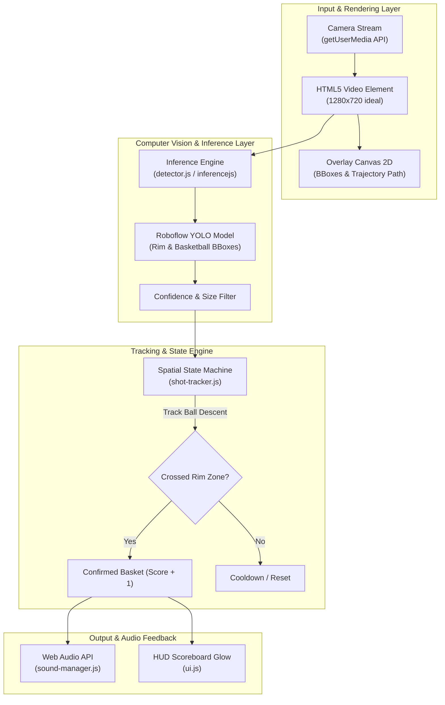

# 🏀 Hoop Shot Counter

<div align="center">


**Real-Time Computer Vision Basketball Shot Tracking & Audio Feedback Web Application**

[Live Demo](#quick-start) • [Architecture](docs/ARCHITECTURE.md) • [Documentation Hub](docs/INDEX.md) • [Roadmap](docs/ROADMAP.md)

</div>

---

## 📖 Overview

**Hoop Shot Counter** is a browser-based, client-side computer vision application designed to automatically track basketball shots and count completed baskets in real time using your device's camera (Webcam or Smartphone). 

Powered by **Roboflow Inference.js** and pre-trained YOLO object detection models, the system tracks the ball's trajectory relative to the rim and triggers instant spatial audio feedback (Swish, Buzzer, Crowd Cheer, or Custom Audio) upon a successful shot.

---

## ✨ Key Features

- 📷 **Real-Time Rim & Ball Detection**: High-performance client-side inference using `inferencejs` running at 10–15+ FPS.
- 🎯 **Finite State Machine Trajectory Tracking**: Robust multi-stage spatial validation (`IDLE` ➔ `TRACKING` ➔ `BALL_ABOVE` ➔ `SCORED` ➔ `COOLDOWN`) to eliminate false positives.
- 🔊 **Dynamic Web Audio System**: Synthesized audio oscillator effects alongside support for custom `.mp3`/`.wav` sound uploads.
- 📱 **Mobile-First & Stadium UI**: Dark glassmorphism interface with neon score counters, live latency metrics, and instant front/rear camera switching.
- 🔒 **Zero-Config Mobile HTTPS & Tunneling**: Built-in HTTPS development server and Cloudflare Tunnel integration for immediate smartphone testing on the court.

---

## 🏗️ System Architecture



---

## 📁 Project Structure

```text
hoop/
├── .agents/                    # Agent Customizations & Skills
│   ├── rules/style.md          # Response & coding style guidelines
│   └── skills/                 # Custom domain skill (hoop-shot-counter)
│
├── docs/                       # Comprehensive Technical Documentation
│   ├── INDEX.md                # Central Documentation Hub & Navigation
│   ├── ARCHITECTURE.md         # Full System Architecture & FSM Logic
│   ├── SPEC.md                 # Technical Specifications & Acceptance Criteria
│   ├── STYLE_GUIDE.md          # UI Design Tokens, Colors & Glassmorphism
│   ├── ROADMAP.md              # Feature Roadmap (Phases 2–4 & WebGPU)
│   ├── DEPLOYMENT.md           # Mobile Tunneling & HTTPS Setup Guide
│   ├── TASK.md                 # Task Checklist & Progress Log
│   ├── IMPLEMENTATION_PLAN.md  # Architectural Decisions & Phase 1 Execution
│   └── PROMPT_GUIDE.md         # AI Prompt Templates & Checklists
│
├── public/                     # Static Assets & Icons
├── scripts/                    # Development & Tunneling Utilities
│   ├── generate-sounds.js      # Synthesize fallback audio files
│   ├── get-ip.js               # Discover local LAN IP for mobile testing
│   └── start-tunnel-cf.js      # Zero-config Cloudflare HTTPS Tunnel
│
├── sounds/                     # Sound Effect Assets (.mp3 / .wav)
│   ├── swoosh.mp3              # Clean net swish effect
│   ├── buzzer.mp3              # Game buzzer sound
│   └── crowd-cheer.mp3         # Crowd cheer effect
│
├── src/                        # Core Application Source Code
│   ├── camera.js               # Camera stream lifecycle & device switcher
│   ├── config.js               # Default thresholds & Roboflow configurations
│   ├── detector.js             # InferenceJS wrapper & detection loop
│   ├── main.js                 # App coordinator & initialization pipeline
│   ├── shot-tracker.js         # Finite State Machine & trajectory calculation
│   ├── sound-manager.js        # Web Audio API engine & custom sound loader
│   └── ui.js                   # HUD overlay, settings modal & DOM manipulation
│
├── styles/
│   └── index.css               # Design system, glassmorphism & responsive rules
│
├── .env.example                # Environment variables template
├── .gitignore                  # Git ignore rules for node_modules, build & secrets
├── GEMINI.md                   # Agent execution instructions
├── index.html                  # Main application entry point
├── package.json                # NPM configuration & scripts
└── vite.config.js              # Vite server & basic-ssl configuration
```

---

## ⚡ Quick Start

### Prerequisites
- [Node.js](https://nodejs.org/) (version 18 or higher recommended)
- A device with a working webcam or smartphone camera
- *(Optional)* [Roboflow API Key](https://roboflow.com/) for custom model training

### Installation

```bash
# 1. Clone the repository
git clone https://github.com/dechatorn-L/Hoop.git
cd Hoop

# 2. Install dependencies
npm install

# 3. Setup environment variables (optional for default key)
cp .env.example .env

# 4. Start local development server (with HTTPS)
npm run dev
```

Open `https://localhost:5173` in your browser. (Accept the self-signed SSL certificate in your browser).

---

## 📱 Testing on Mobile / Outdoor Court

To use your smartphone camera on an actual basketball hoop, you need an HTTPS connection to grant camera permissions:

### Option 1: Zero-Config Cloudflare Tunnel (Recommended)
```bash
npm run tunnel:cf
```
*Generates a public temporary HTTPS URL (e.g. `https://xxxx.trycloudflare.com`) accessible from any mobile browser.*

### Option 2: Local Area Network (Wi-Fi)
```bash
npm run ip
# Then connect to https://<YOUR_LOCAL_IP>:5173 on your mobile phone on the same Wi-Fi
```

---

## 📚 Documentation Suite

| Document | Description |
|---|---|
| [**INDEX.md**](docs/INDEX.md) | Central hub and overview for all project documentation |
| [**ARCHITECTURE.md**](docs/ARCHITECTURE.md) | Deep dive into FSM state transitions, coordinate mapping, and module APIs |
| [**SPEC.md**](docs/SPEC.md) | Formal functional requirements, FPS limits, and detection tolerances |
| [**STYLE_GUIDE.md**](docs/STYLE_GUIDE.md) | UI design system, color tokens (`#FF6B35`), and typography |
| [**ROADMAP.md**](docs/ROADMAP.md) | Strategic feature expansions (Accuracy %, Pose estimation, WebGPU) |
| [**DEPLOYMENT.md**](docs/DEPLOYMENT.md) | HTTPS configuration, local tunnel setup, and mobile troubleshooting |
| [**TASK.md**](docs/TASK.md) | Detailed sprint checklist and verification history |

---

## 🌐 Browser Compatibility

| Browser | Platform | Support | Notes |
|---|---|---|---|
| **Google Chrome** | Desktop / Android | ✅ Recommended | Full WebGL & Web Audio hardware acceleration |
| **Safari** | iOS (14.3+) / macOS | ✅ Supported | Requires HTTPS for `getUserMedia` |
| **Mozilla Firefox** | Desktop / Android | ✅ Supported | Full support |
| **Microsoft Edge** | Desktop | ✅ Supported | Chromium engine |

---

## 📄 License

This project is licensed under the [MIT License](LICENSE).
