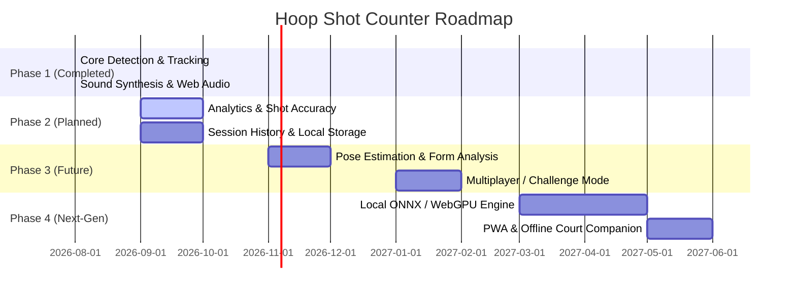

# 🚀 Product Roadmap & Vision — Hoop Shot Counter

This document outlines the strategic roadmap, planned architectural enhancements, and future milestones for the **Hoop Shot Counter** project.

---

## 🗺️ Release Milestones

---

## 🌟 Phase Breakdown

### ✅ Phase 1: Core Engine & Real-Time Tracking (Current)
- [x] Web camera stream integration with rear/front switcher (`getUserMedia`).
- [x] Client-side YOLO object detection powered by Roboflow `inferencejs`.
- [x] Heuristic spatial trajectory analysis (IDLE → TRACKING → BALL_ABOVE → SCORED → COOLDOWN).
- [x] Web Audio API sound synthesis and custom audio upload.
- [x] Mobile-responsive dark glassmorphism UI.
- [x] Cloudflare Tunneling and local HTTPS support for mobile testing.

---

### 🟡 Phase 2: Analytics, Accuracy & Shot Breakdown
- [ ] **Shot Attempt & Accuracy Tracking**: Detect both missed shots and made shots to compute Shooting Percentage ($FG\% = \frac{\text{Made}}{\text{Attempts}} \times 100$).
- [ ] **Streak & Heat Multiplier**: Fire effects and audio escalation for consecutive baskets (e.g., 3-in-a-row "He's on fire!").
- [ ] **Session Summary & Charts**: Real-time Chart.js integration showing shots per minute, scoring velocity, and workout duration.
- [ ] **IndexedDB / Local Storage**: Export session logs as CSV or JSON with timestamped shot events.

---

### 🔵 Phase 3: Player Pose Estimation & Shooting Form
- [ ] **MediaPipe Pose Integration**: Track release angle, elbow alignment, and jump height.
- [ ] **Release Point Detection**: Synchronize ball release timestamp with shooter body kinematics.
- [ ] **Audio Coach**: Real-time voice feedback (e.g., "Good follow-through", "High arc").
- [ ] **Leaderboards & Peer Challenges**: Timed 60-second shootouts with audio countdowns.

---

### 🟣 Phase 4: Offline Engine & WebGPU Optimization
- [ ] **ONNX Runtime Web / WebGPU**: Run custom YOLO models directly in the browser with zero cloud latency and no API keys required.
- [ ] **Progressive Web App (PWA)**: Installable on iOS/Android home screens with offline sound asset caching.
- [ ] **Multi-Angle Synchronized Tracking**: Multi-phone camera mesh to capture rim and shooter perspectives simultaneously.
