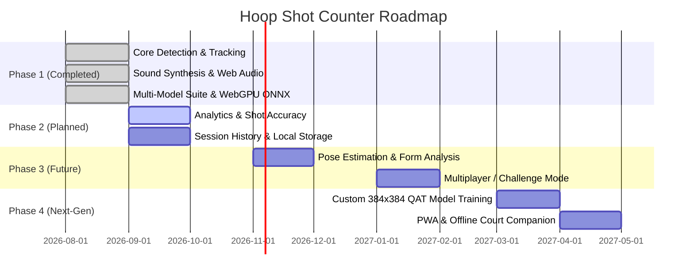

# 🚀 Product Roadmap & Vision — Hoop Shot Counter

This document outlines the strategic roadmap, planned architectural enhancements, and future milestones for the **Hoop Shot Counter** project.

---

## 🗺️ Release Milestones

---

## 🌟 Phase Breakdown

### ✅ Phase 1: Core Engine, Real-Time Tracking & WebGPU Suite (Completed)
- [x] Web camera stream integration with rear/front switcher (`getUserMedia`).
- [x] Client-side YOLO object detection powered by Roboflow `inferencejs` with 5 presets.
- [x] Dedicated Web Worker WebGPU hardware-accelerated ONNX Runtime (`src/worker/onnx.worker.js` ~30.9ms).
- [x] True 60 FPS Kinematic Projectile Extrapolator ($g = 980\text{ px/s}^2$).
- [x] Continuous Trajectory Raycast Crossing & Rebound Rejection.
- [x] Universal Manual Rim ROI Pinning Mode & ⚡ Hoop ROI Turbo mode (3x speedup).
- [x] Web Audio API low-latency sound player (`cha-ching.wav`, `fahhhh.wav`, `green-giant.wav`) and custom upload.
- [x] All-in-One Cloudflare Tunneling (`npm run tunnel:cf`) and Local HTTPS.

---

### 🟡 Phase 2: Analytics, Accuracy & Shot Breakdown (Active / Next)
- [ ] **Shot Attempt & Accuracy Tracking**: Detect both missed shots and made shots to compute Shooting Percentage ($FG\% = \frac{\text{Made}}{\text{Attempts}} \times 100$).
- [ ] **Streak & Heat Multiplier**: Fire effects and audio escalation for consecutive baskets (e.g., 3-in-a-row "He's on fire!").
- [ ] **Session Summary & Charts**: Real-time Chart.js integration showing shots per minute, scoring velocity, and workout duration.
- [ ] **IndexedDB / Local Storage**: Export session logs as CSV or JSON with timestamped shot events.

---

### 🔵 Phase 3: Player Pose Estimation & Shooting Form
- [ ] **MediaPipe Pose Integration**: Track release angle, elbow alignment, and jump height.
- [ ] **Release Point Detection**: Synchronize ball release timestamp with shooter body kinematics.
- [ ] **Audio Coach**: Real-time voice feedback (e.g., "Good follow-through", "High arc").
- [ ] **Leaderboards & Peer Challenges**: Timed 60-second shootouts with audio countdowns.

---

### 🟣 Phase 4: Next-Gen Optimization & Progressive Web App
- [x] **Local ONNX / WebGPU Engine**: Run custom YOLO models in browser with ~30.9ms latency (Done).
- [x] **Universal Manual Rim ROI Calibration**: Drag and pin rim on canvas with `localStorage` persistence (Done).
- [ ] **Custom 384x384 QAT Model Training**: Train YOLOv8n from epoch 0 at 384x384 resolution with INT8 Quantization (~3-4 MB).
- [ ] **Progressive Web App (PWA)**: Installable on iOS/Android home screens with full offline caching.
